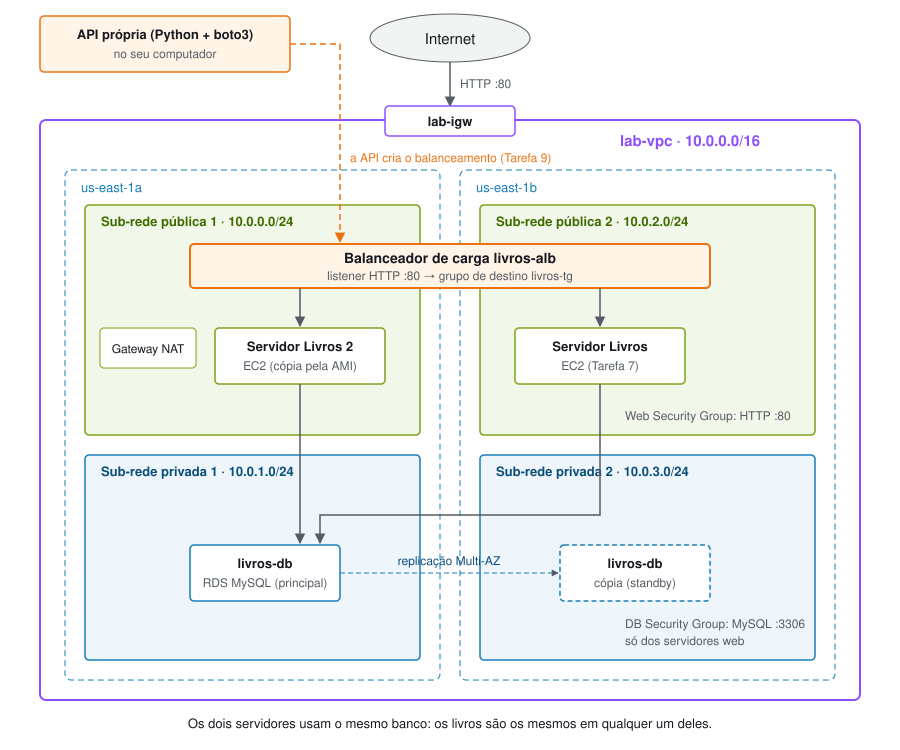
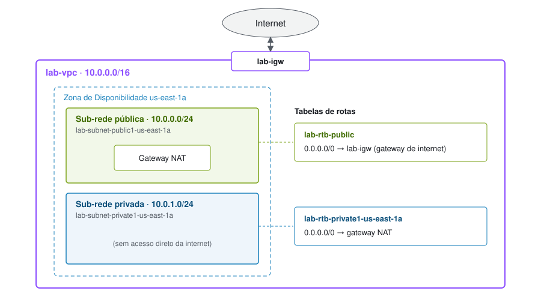
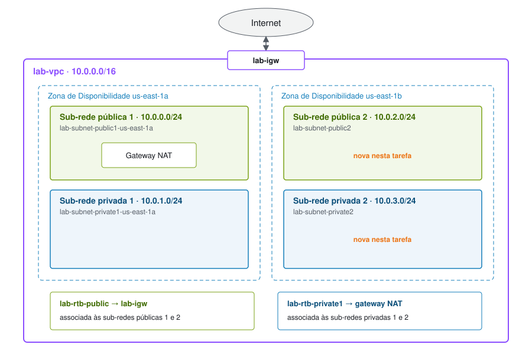

# Livros Recomendados: VM, aplicação web e banco de dados na AWS

**Elaborado por Bruna Cristina Kato Baptista e Elizeu Elias Ribeiro**

Projeto final da disciplina Fundamentos de Computação em Nuvem.

## Visão geral e objetivos

Neste projeto, você criará uma VPC própria, um banco de dados MySQL no Amazon RDS e um servidor web no
Amazon EC2 com a aplicação **Livros Recomendados**. Em seguida, uma **API própria** colocará um
balanceador de carga na frente de dois servidores.

O projeto junta o que foi feito nos laboratórios:

| Parte do projeto | Laboratório de referência | Tarefas |
|---|---|---|
| 1. Máquina virtual + página web | Lab 2 (VPC e servidor web) e Lab 3 (EC2) | 1, 2, 3 e 7 |
| 2. Banco de dados | Lab 5 (RDS) | 4, 5, 6 e 8 |
| 3. Balanceamento de carga, por uma API própria | Lab 6 (ELB) | 9 |

Depois de concluir o projeto, você será capaz de:

- Criar uma VPC com sub-redes públicas e privadas em duas Zonas de Disponibilidade.
- Configurar grupos de segurança para o servidor web e para o banco de dados.
- Executar um banco de dados Amazon RDS Multi-AZ.
- Executar um servidor web com um script de dados do usuário que baixa a aplicação.
- Conectar a aplicação ao banco e cadastrar livros.
- Criar um balanceador de carga usando uma API própria, que envia comandos para a AWS.

## Duração

O projeto leva aproximadamente **60 minutos**, contando as esperas do banco de dados e do balanceador.

## Restrições de serviço da AWS

No ambiente do Learner Lab, alguns serviços e ações podem estar restritos. Se aparecer um erro de
permissão, confira se a região é **Norte da Virgínia (us-east-1)** e se os tipos escolhidos são
**t2.micro** (EC2) e **db.t3.micro** (RDS).

## Arquitetura final



---

## Preparação: publicar a aplicação no GitHub

O servidor web baixará a aplicação de um repositório público no GitHub, assim como no Lab 2 o servidor
baixa o `lab-app.zip`.

1. Acesse https://github.com e escolha **New repository**.
   - **Repository name:** `livros-app`
   - Selecione **Public**.
   - Escolha **Create repository**.

2. Selecione **uploading an existing file** e arraste os arquivos e as pastas desta aplicação (`index.php`,
   `rds.php`, as pastas `sql` e `css` etc.). Escolha **Commit changes**.

3. Confirme que o download funciona abrindo no navegador:
   `https://github.com/SEU-USUARIO/livros-app/archive/refs/heads/main.zip`

   O repositório pode ser público porque não contém nenhuma senha: a conexão com o banco é informada na
   página RDS da aplicação (Tarefa 8) e fica gravada somente dentro do servidor.

## Acessar o Console de Gerenciamento da AWS

4. No Learner Lab, escolha **Start Lab** e aguarde até o ícone ao lado de **AWS** ficar verde.

5. Escolha **AWS** para abrir o console em uma nova guia.

**Dica:** os valores que aparecem `neste formato` devem ser digitados exatamente como estão.

---

## Tarefa 1: Criar a VPC

Nesta tarefa, você usará a opção *VPC e muito mais* no console da VPC para criar vários recursos de uma vez:
uma *VPC*, um *gateway de internet*, uma *sub-rede pública* e uma *sub-rede privada* em uma Zona de
Disponibilidade, duas *tabelas de rotas* e um *gateway NAT*.

6. Na caixa de pesquisa à direita de **Serviços**, procure e selecione **VPC**.

7. Comece a criar a VPC.
   - No canto superior direito, confirme se a região é **Norte da Virgínia (us-east-1)**.
   - Selecione **Painel da VPC** e depois **Criar VPC**.

8. Configure os detalhes no painel *Configurações da VPC*:
   - Escolha **VPC e muito mais**.
   - Em **Geração automática da etiqueta de nome**, mantenha *Gerar automaticamente* e altere o valor para `lab`.
   - Mantenha **Bloco CIDR IPv4** como `10.0.0.0/16`.
   - **Número de zonas de disponibilidade:** **1**
   - **Número de sub-redes públicas:** **1**
   - **Número de sub-redes privadas:** **1**
   - Expanda **Personalizar blocos CIDR de sub-redes**:
     - **Public subnet CIDR block in us-east-1a:** `10.0.0.0/24`
     - **Private subnet CIDR block in us-east-1a:** `10.0.1.0/24`
   - **Gateways NAT:** **In 1 AZ**
   - **Endpoints da VPC:** **Nenhum**
   - Mantenha **Nomes de host DNS** e **Resolução de DNS** ativados.

9. No painel *Visualização*, confirme os nomes: `lab-vpc`, `lab-subnet-public1-us-east-1a`,
   `lab-subnet-private1-us-east-1a`, `lab-rtb-public`, `lab-rtb-private1-us-east-1a`, `lab-igw` e
   `lab-nat-public1-us-east-1a`.

10. Escolha **Criar VPC** e aguarde até que *todos* os recursos sejam criados. O gateway NAT leva alguns minutos.

11. Escolha **Visualizar VPC**.

    O *gateway de internet* permite a comunicação entre a VPC e a internet. A sub-rede pública
    `lab-subnet-public1-us-east-1a` (**10.0.0.x**) é pública porque a tabela de rotas dela envia o
    tráfego `0.0.0.0/0` para o gateway de internet.

    O *gateway NAT* permite que recursos nas sub-redes *privadas* acessem a internet sem receber
    conexões vindas dela. A sub-rede privada `lab-subnet-private1-us-east-1a` contém os endereços **10.0.1.x**.

    

## Tarefa 2: Criar sub-redes adicionais

Nesta tarefa, você criará uma segunda sub-rede pública e uma segunda sub-rede privada em outra Zona de
Disponibilidade. O banco de dados exige sub-redes em duas zonas, e o balanceador de carga também.

12. No painel de navegação à esquerda, escolha **Sub-redes**.

13. Selecione **Criar sub-rede** e configure:
    - **ID da VPC:** **lab-vpc**
    - **Nome da sub-rede:** `lab-subnet-public2`
    - **Zona de Disponibilidade:** a *segunda* zona (por exemplo, us-east-1b)
    - **Bloco CIDR IPv4:** `10.0.2.0/24`

14. Escolha **Criar sub-rede**.

15. Selecione **Criar sub-rede** novamente e configure:
    - **ID da VPC:** `lab-vpc`
    - **Nome da sub-rede:** `lab-subnet-private2`
    - **Zona de Disponibilidade:** a *segunda* zona (por exemplo, us-east-1b)
    - **Bloco CIDR IPv4:** `10.0.3.0/24`

16. Escolha **Criar sub-rede**.

    Agora, você associará cada nova sub-rede à tabela de rotas certa. Uma *tabela de rotas* contém as
    regras que definem para onde o tráfego de rede é enviado.

17. No painel de navegação à esquerda, selecione **Tabelas de rotas**.

18. Selecione a tabela **lab-rtb-private1-us-east-1a** e, no painel inferior, a guia **Rotas**.

    O destino `0.0.0.0/0` aponta para **nat-xxxxxxxx**: o tráfego para a internet sai pelo gateway NAT.

19. Escolha a guia **Associações de sub-rede** → **Editar associações de sub-rede**.

20. Mantenha **lab-subnet-private1-us-east-1a** selecionada, selecione também **lab-subnet-private2**
    e escolha **Salvar associações**.

21. Selecione a tabela **lab-rtb-public** (desmarque as demais) e confira na guia **Rotas** que
    `0.0.0.0/0` aponta para **igw-xxxxxxxx**, o gateway de internet.

22. Na guia **Associações de sub-rede**, escolha **Editar associações de sub-rede**.

23. Mantenha **lab-subnet-public1-us-east-1a** selecionada, selecione também **lab-subnet-public2** e
    escolha **Salvar associações**.

    A VPC agora tem sub-redes públicas e privadas em duas Zonas de Disponibilidade.

    

## Tarefa 3: Criar o grupo de segurança do servidor web

Nesta tarefa, você criará um grupo de segurança, que atua como um firewall virtual, permitindo acesso
HTTP aos servidores web.

24. No painel de navegação à esquerda, escolha **Grupos de segurança**.

25. Selecione **Criar grupo de segurança** e configure:
    - **Nome do grupo de segurança:** `Web Security Group`
    - **Descrição:** `Enable HTTP access`
    - **VPC:** selecione o X para remover a VPC selecionada e escolha **lab-vpc**.

26. Em **Regras de entrada**, selecione **Adicionar regra** e configure:
    - **Tipo:** *HTTP*
    - **Origem:** *Anywhere-IPv4*
    - **Descrição:** `Permit web requests`

27. Escolha **Criar grupo de segurança**.

## Tarefa 4: Criar o grupo de segurança do banco de dados

Nesta tarefa, você criará o grupo de segurança do banco, permitindo conexões **somente** dos servidores
que estão no Web Security Group. Ele precisa ser criado depois do Web Security Group, porque aponta para ele.

28. Em **Grupos de segurança**, selecione **Criar grupo de segurança** e configure:
    - **Nome do grupo de segurança:** `DB Security Group`
    - **Descrição:** `Permit access from Web Security Group`
    - **VPC:** **lab-vpc**

29. Em **Regras de entrada**, selecione **Adicionar regra** e configure:
    - **Tipo:** *MySQL/Aurora (3306)*
    - **Origem:** clique no campo ao lado de *Personalizado*, digite `sg` e selecione *Web Security Group*.

    Essa regra permite tráfego na porta 3306 apenas de instâncias associadas ao *Web Security Group*.
    Nenhum outro endereço da internet consegue se conectar ao banco.

30. Escolha **Criar grupo de segurança**.

## Tarefa 5: Criar um grupo de sub-redes do banco de dados

Nesta tarefa, você criará um *DB subnet group*, que informa ao RDS em quais sub-redes o banco pode ficar.
Cada grupo exige sub-redes em pelo menos duas Zonas de Disponibilidade.

31. Na caixa de pesquisa à direita de **Serviços**, procure e selecione **RDS**.

32. No painel de navegação à esquerda, escolha **Grupos de sub-redes**.

33. Escolha **Criar grupo de sub-redes de banco de dados** e configure:
    - **Nome:** `DB-Subnet-Group`
    - **Descrição:** `DB Subnet Group`
    - **VPC:** **lab-vpc**

34. Em **Adicionar sub-redes**:
    - **Zonas de disponibilidade:** selecione **us-east-1a** e **us-east-1b**.
    - **Sub-redes:** selecione as sub-redes privadas **10.0.1.0/24** e **10.0.3.0/24**.

35. Escolha **Criar**.

## Tarefa 6: Criar a instância de banco de dados do Amazon RDS

Nesta tarefa, você criará um banco MySQL **Multi-AZ**. O RDS mantém uma instância principal e uma cópia
sincronizada (*standby*) em outra Zona de Disponibilidade. Se a principal falhar, o RDS passa a usar a cópia.

36. No painel de navegação à esquerda, escolha **Bancos de dados** e depois **Criar banco de dados**.

37. Em **Opções do mecanismo**, selecione **MySQL**.

38. Em **Modelos**, escolha **Dev/Test**.

39. Em **Disponibilidade e durabilidade**, escolha **Instância de banco de dados Multi-AZ**.

40. Em **Configurações**:
    - **Identificador da instância de banco de dados:** `livros-db`
    - **Nome de usuário principal:** `main`
    - **Senha principal** e **Confirmar senha:** uma senha sua, com letras e números. Anote: ela será
      usada na Tarefa 8.

41. Em **Configuração da instância**, selecione **Classes com capacidade de intermitência** e *db.t3.micro*.

42. Em **Armazenamento**: **Tipo de armazenamento** *SSD de uso geral* e **Armazenamento alocado** `20`.

43. Em **Conectividade**:
    - **Nuvem privada virtual (VPC):** **lab-vpc**
    - **Grupo de sub-redes de banco de dados:** *db-subnet-group*
    - **Acesso público:** *Não*
    - **Grupos de segurança de VPC existentes:** escolha *DB Security Group* e remova o *default*.

44. Em **Monitoramento**, desmarque **Habilitar o monitoramento avançado**.

45. Em **Configuração adicional**:
    - **Nome do banco de dados inicial:** `livrosdb`
    - Desmarque **Habilitar backups automatizados**.
    - Desmarque **Habilitar criptografia**.

46. Escolha **Criar banco de dados**.

    Se aparecer um erro com *iam:CreateRole*, confira se o monitoramento avançado foi desmarcado.

47. Escolha **livros-db** e aguarde o status mudar para **Disponível** (cerca de 10 minutos, por ser Multi-AZ).

48. Na seção **Conectividade e segurança**, copie o **Endpoint** (algo como
    `livros-db.xxxx.us-east-1.rds.amazonaws.com`) e guarde em um editor de texto.

Enquanto o banco é criado, você pode fazer a Tarefa 7.

## Tarefa 7: Executar o servidor web

Nesta tarefa, você executará uma instância do EC2 na sub-rede pública. Um script de dados do usuário
instalará o Apache e o PHP e baixará a aplicação do GitHub, como no Lab 2.

49. Na caixa de pesquisa à direita de **Serviços**, procure e selecione **EC2**.

50. No menu **Executar instância**, selecione **Executar instância**.

51. Dê o nome `Servidor Livros`.

52. Em **AMI**, mantenha **Amazon Linux** e **Amazon Linux 2023 AMI**.

53. Em **Tipo de instância**, mantenha **t2.micro**.

54. Em **Nome do par de chaves**, selecione **vockey**.

55. Ao lado de **Configurações de rede**, selecione **Editar** e configure:
    - **Rede:** *lab-vpc*
    - **Sub-rede:** *lab-subnet-public2* (*não* a privada)
    - **Atribuir IP público automaticamente:** *Ativar*
    - **Firewall (grupos de segurança):** **Selecionar grupo de segurança existente** → **Web Security Group**

56. Mantenha o armazenamento padrão.

57. Expanda **Detalhes avançados** e cole o script abaixo em **Dados do usuário**, trocando `SEU-USUARIO`
    pelo seu usuário do GitHub:

    ```bash
    #!/bin/bash
    # Install Apache Web Server and PHP
    dnf install -y httpd wget unzip php php-mysqli
    # Download app files
    wget https://github.com/BrunaCristinaBaptista/livros-app/archive/refs/heads/main.zip
    unzip main.zip
    cp -r livros-app-main/* /var/www/html/
    # Config file for the RDS form (outside the public folder)
    touch /var/www/livros-config.php
    chown apache:apache /var/www/livros-config.php
    chmod 600 /var/www/livros-config.php
    # Turn on web server
    chkconfig httpd on
    service httpd start
    ```

    O script roda como usuário raiz, uma única vez, quando a instância é criada. Ele instala o servidor
    web e o PHP com suporte a MySQL, baixa a aplicação, prepara o arquivo onde a conexão com o banco será
    gravada e liga o servidor web.

58. Escolha **Executar instância** e depois **Visualizar todas as instâncias**.

59. Aguarde o **Servidor Livros** mostrar *2/2 verificações aprovadas*.

60. Selecione o **Servidor Livros** e copie o **Endereço IPv4 público** na guia **Detalhes**.

61. Abra uma nova guia, digite `http://` seguido do IP público e pressione Enter. Use **http**, não https.

    A página mostra o **Instance ID**, a **Availability Zone** e a carga da CPU do servidor.

## Tarefa 8: Conectar a aplicação ao banco de dados

Nesta tarefa, você conectará a aplicação ao banco criado na Tarefa 6, como na Tarefa 4 do Lab 5.

62. Na página da aplicação, escolha **RDS** no menu.

63. Preencha:
    - **Endpoint:** o endpoint copiado na Tarefa 6
    - **Database:** `livrosdb`
    - **Username:** `main`
    - **Password:** a senha definida na Tarefa 6

    Escolha **Submit**.

    A aplicação testa a conexão, executa o script `sql/livros.sql` (que cria as tabelas e cadastra 9
    livros iniciais) e grava a configuração. Em 5 segundos, abre a lista de **Livros recomendados**.

64. Teste a aplicação: escolha **Adicionar livro**, **Editar** e **Remover**.

    Os dados ficam no banco RDS, e não no servidor. A cópia Multi-AZ é atualizada automaticamente na
    segunda Zona de Disponibilidade.

## Tarefa 9: Criar o balanceamento de carga com a API própria

Nesta tarefa, uma **API própria**, escrita em Python (Flask + boto3), enviará os comandos para a AWS
montar o balanceamento de carga, como no Lab 6. A API está na pasta `api-balanceamento`.

65. No seu computador, configure as credenciais: no Learner Lab, abra **AWS Details** → **AWS CLI: Show**
    e cole o conteúdo em `~/.aws/credentials`.

66. Instale e ligue a API:

    ```bash
    cd api-balanceamento
    python3 -m venv .venv
    source .venv/bin/activate
    pip install -r requirements.txt
    python3 api_balanceamento.py
    ```

67. Em outro terminal, envie o pedido:

    ```bash
    curl -X POST http://localhost:5000/balanceamento
    ```

    A API executa cinco passos (de 8 a 12 minutos):
    1. Cria uma AMI (cópia do disco) do **Servidor Livros**.
    2. Cria o **Servidor Livros 2** a partir da AMI, na outra sub-rede pública.
    3. Cria o grupo de destino `livros-tg`, com verificação de saúde na página inicial.
    4. Cria o balanceador `livros-alb` nas duas sub-redes públicas, com um listener na porta 80.
    5. Registra os dois servidores e aguarda os dois ficarem *healthy*.

    Durante o passo 1, o Servidor Livros reinicia por cerca de 1 minuto.

68. Abra a **url** devolvida pela API e atualize a página algumas vezes. O **Instance ID** alterna entre
    os dois servidores, e a lista de livros na página **RDS** é a mesma nos dois, porque eles usam o mesmo banco.

69. Consulte a saúde dos servidores:

    ```bash
    curl http://localhost:5000/status
    ```

70. Teste a alta disponibilidade: no console do EC2, selecione **Servidor Livros 2** → **Estado da
    instância** → **Interromper instância**. Em até 30 segundos, o `/status` mostra esse servidor como
    *unhealthy*, e a aplicação continua no ar pelo outro servidor.

## Limpeza

O balanceador, o gateway NAT e o banco Multi-AZ consomem crédito do Learner Lab enquanto existirem.

71. Desfaça o balanceamento: `curl -X DELETE http://localhost:5000/balanceamento`

72. No EC2, encerre o **Servidor Livros**.

73. No RDS, exclua o **livros-db** (desmarque *Criar snapshot final*) e, depois, o **DB-Subnet-Group**.

74. Na VPC, exclua o **DB Security Group** e depois o **Web Security Group**.

75. Exclua o gateway NAT (**Gateways NAT**) e libere o **IP elástico** dele.

76. Exclua a **lab-vpc** (**Suas VPCs** → **Ações** → **Excluir VPC**).

---

## Estrutura da aplicação

```
livros-app/
├── index.php            # página inicial: Instance ID, zona e carga da CPU
├── load.php             # Load Test
├── rds.php              # decide: formulário de conexão ou lista de livros
├── rds-config.php       # formulário Endpoint / Database / Username / Password
├── rds-write-config.php # testa a conexão, executa o sql/livros.sql e grava a configuração
├── rds-livros.php       # lista de livros (adicionar, editar, remover)
├── comum.php            # funções usadas por todas as páginas
├── menu.php             # menu do topo
├── sql/livros.sql       # cria as tabelas (livros e créditos) e cadastra 9 livros iniciais
├── css/style.css
└── user-data.sh         # script de dados do usuário (Tarefa 7)
```

Os códigos dos livros iniciais no `sql/livros.sql` são exemplos no formato de número de chamada.
Substitua pelos códigos reais do catálogo da biblioteca.

## Diferenças em relação à aplicação do laboratório

| Na aplicação do laboratório | Nesta aplicação |
|---|---|
| O texto digitado entra direto no SQL (SQL injection) | Prepared statements (`prepare` + `bind_param`) |
| Os dados são exibidos sem escapar (XSS) | `htmlspecialchars` em tudo o que é exibido |
| Remover é um link (`?mode=remove&id=3`) | Remover é um botão (POST) |
| A senha do banco fica em `/var/www/html` (pasta pública) | Em `/var/www/livros-config.php`, fora da pasta pública, com `chmod 600` |
| A senha aparece na tela durante a configuração | A senha nunca é exibida |
| Funções `mysql_*`, que não existem no PHP 7 ou superior | `mysqli`, compatível com o PHP atual |
| O formulário pode ser reenviado e troca o banco | Depois de configurado, o banco não pode ser trocado pela página |

**Limitação conhecida:** qualquer pessoa com o endereço pode adicionar, editar e remover livros, como
na aplicação do laboratório.

---

*Elaborado por Bruna Cristina Kato Baptista e Elizeu Elias Ribeiro.*
